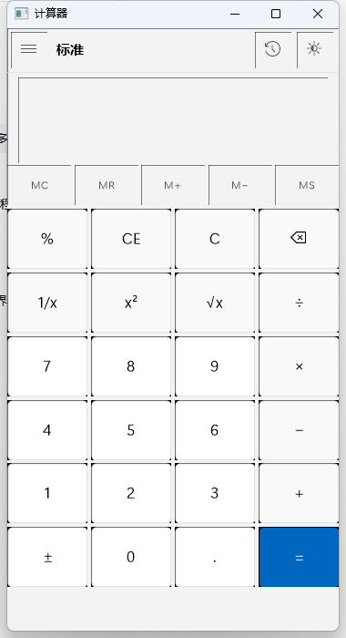
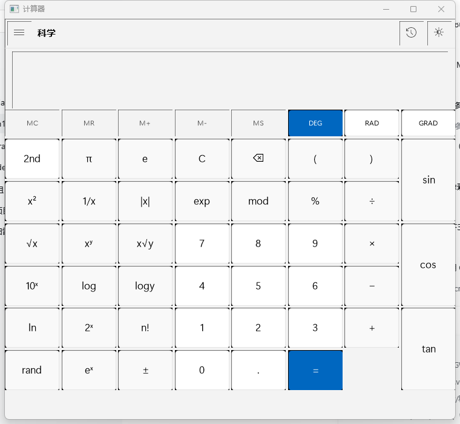
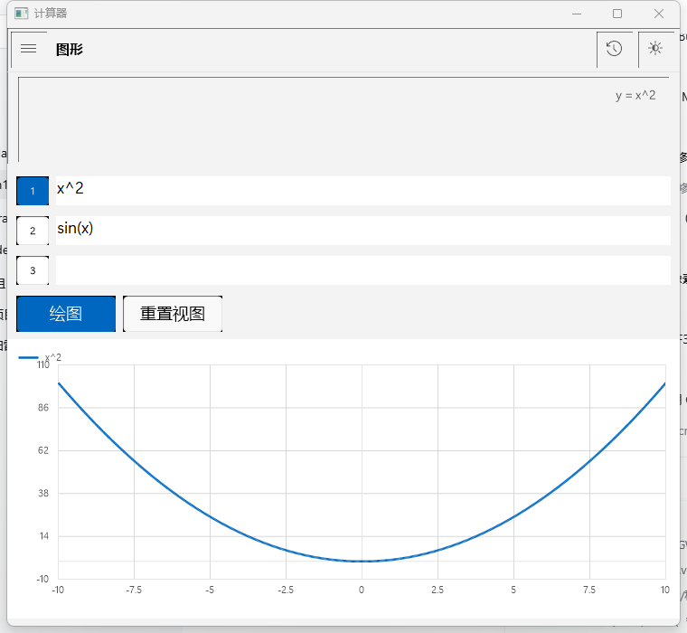
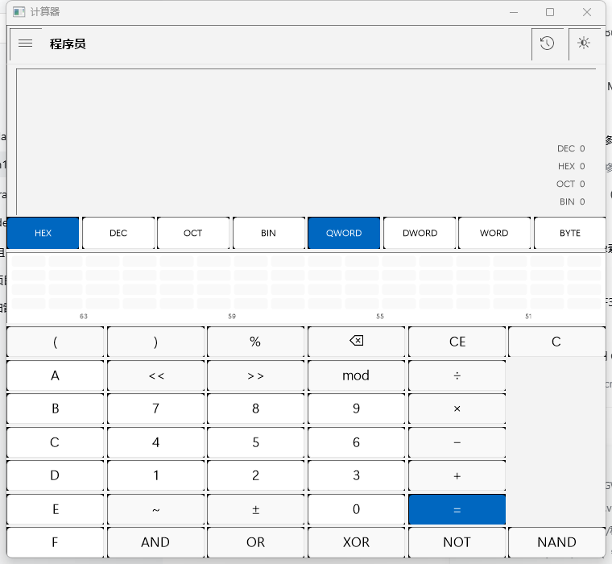
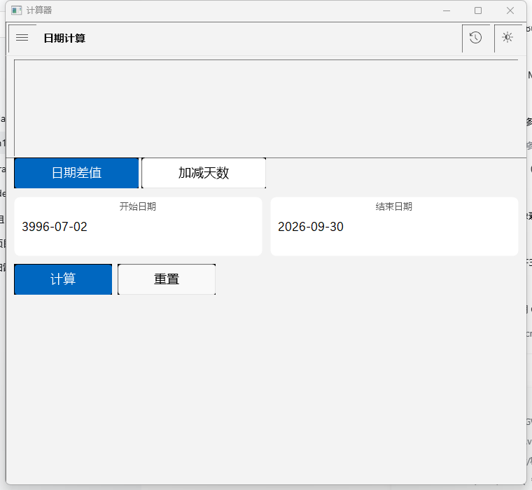
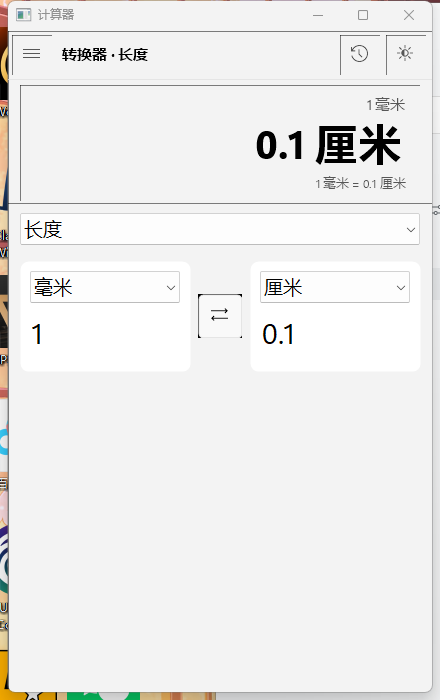

# 计算器（Calculator）

一款仿 Windows 11 风格的桌面计算器，使用 C++17 / Win32 / GDI+ 编写，包含标准、科学、图形、程序员、日期计算、单位转换器六大模式，支持计算历史、记忆功能、键盘快捷键与浅色/深色主题，可在 Windows 10/11 上直接运行。

`C++17` · `Windows 10/11` · `MSVC（Win32 + GDI+）` · `x64 Release`

---

## 目录

1. [功能总览](#1-功能总览)
2. [界面截图](#2-界面截图)
3. [快速开始](#3-快速开始)
4. [各模式使用说明](#4-各模式使用说明)
5. [快捷键一览表](#5-快捷键一览表)
6. [历史记录与记忆](#6-历史记录与记忆)
7. [单位转换器类别与单位清单](#7-单位转换器类别与单位清单)
8. [项目结构](#8-项目结构)
9. [架构设计简述](#9-架构设计简述)
10. [编译与测试](#10-编译与测试)
11. [已知限制](#11-已知限制)
12. [常见问题](#12-常见问题)

---

## 1. 功能总览

| 模块 | 说明 |
| --- | --- |
| 标准模式 | 基础四则运算、百分比、倒数/平方/开方、± 取反、记忆功能 |
| 科学模式 | 三角函数与反三角函数、幂/对数、阶乘、双参数函数、DEG/RAD/GRAD 角度制、2nd 第二功能切换 |
| 图形模式 | 最多 3 条函数曲线，滚轮缩放、拖拽平移、双击复位、自动适配 y 轴 |
| 程序员模式 | HEX/DEC/OCT/BIN 进制、QWORD/DWORD/WORD/BYTE 字长、64 位位翻转网格、位运算、二进制补码、四种进制明细 |
| 日期计算 | 两个日期的差值（总天数 + 年/月/日分解）、基准日期加减天/周/月/年、闰年与月末裁剪、星期显示 |
| 单位转换器 | 14 类共 113 个单位，双向即时换算，含货币（内置参考汇率，非实时） |
| 历史记录 | 自动记录计算过程，最多 500 条，双击载入结果，支持删除选中/清除全部，持久化保存 |
| 快捷键 | 数字与小键盘、四则运算、Enter/=、Esc、Backspace、Del、F9，科学/程序员模式另有专属按键 |
| 主题 | 启动时跟随系统浅/深色设置，顶栏与导航菜单可手动切换，深色模式含沉浸式标题栏 |

---

## 2. 界面截图

**标准模式** —— 4 列数字键盘与 MC/MR/M+/M−/MS 记忆条，输入时实时显示表达式与结果：



**科学模式** —— 8 列键盘 + 三角函数侧栏，含 2nd 切换与 DEG/RAD/GRAD 角度制：



**图形模式** —— 最多 3 条函数曲线，带网格、坐标刻度与图例，支持缩放和平移：



**程序员模式** —— 进制/字长切换、64 位位翻转网格与位运算键盘，显示区列出四种进制明细：



**日期计算** —— 日期差值卡片显示总天数、年/月/日分解与两端的星期：



**转换器** —— 类别下拉 + 双向换算双卡片，输入任意一侧即时算出另一侧：



---

## 3. 快速开始

### 直接运行

无需安装，双击项目根目录的 `Calculator.exe`（或 `bin\x64\Release\Calculator.exe`，两者为同一 Release|x64 产物）即可启动。

### 首次编译

方式一（Visual Studio）：

1. 用 Visual Studio 打开 `Calculator.sln`；
2. 配置选择 **Release | x64**；
3. 菜单“生成 → 生成解决方案”（或按 `Ctrl+Shift+B`）；
4. 产物输出到 `bin\x64\Release\Calculator.exe`。

方式二（命令行）：双击运行 `build.bat`，脚本会自动查找 MSBuild 并编译 Release|x64。

> 注意：项目使用 **v145** 工具集（Visual Studio 2026）。若使用 VS2022，需先把 `Calculator.vcxproj` 中 4 处 `PlatformToolset` 由 `v145` 改为 `v143`，详见[编译与测试](#10-编译与测试)。

---

## 4. 各模式使用说明

左上角汉堡菜单（☰）可切换模式；顶栏会显示当前模式名称。

### 4.1 标准模式

| 按键 | 功能 |
| --- | --- |
| `%` | 百分比（语义见下表） |
| `CE` | 清除当前正在输入的数字，保留前面已输入的算式 |
| `C` | 全部清除（表达式与结果） |
| `⌫` | 退格：删除最后一个字符（数字只删一位） |
| `1/x`、`x²`、`√x` | 对当前表达式整体取倒数 / 平方 / 开方 |
| `±` | 对当前输入项取反（无输入项时对整个表达式取反） |
| `÷ × − + =` | 四则运算与等号 |
| `MC MR M+ M− MS` | 记忆操作（见[历史记录与记忆](#6-历史记录与记忆)） |

输入过程中表达式下方会**实时显示**当前求值结果；按 `=` 确认结果并写入历史。

**百分比规则**（与 Windows 计算器一致）：

| 输入 | 结果 | 规则 |
| --- | --- | --- |
| `50+10%` | `55` | 加减法：`A±B%` 按 `A ± A×B/100` 计算 |
| `200×10%` | `20` | 乘除等其他运算：`B%` 按 `B/100` 计算 |
| `50%` | `0.5` | 单独百分号：除以 100 |

### 4.2 科学模式

- 记忆条增加 `DEG` / `RAD` / `GRAD` 三个互斥的角度制切换键，sin/cos/tan 及反三角函数按所选角度制解释；
- `2nd` 切换第二功能，共 7 组按键在两种功能间切换：

| 常态 | 2nd 状态 |
| --- | --- |
| sin | sin⁻¹ |
| cos | cos⁻¹ |
| tan | tan⁻¹ |
| xʸ | x√y |
| 10ˣ | 2ˣ |
| log | logy（以 y 为底的对数） |
| ln | eˣ |

- 其他按键：`π`、`e`、`n!`（阶乘）、`|x|`（绝对值）、`exp`（eˣ）、`rand`（0~1 随机数）、`mod`（双参数取模）、`xroot`（双参数开任意次方）、`( )` 括号；
- 该模式的 `eˣ` 键复用标准模式 CE 键位；`x√y`、`logy`、`mod` 等双参数函数按 `函数名(a,b)` 形式插入，引擎自动补括号；
- 表达式引擎支持隐式乘法（如 `2π`、`2(3+1)`）、科学计数法（如 `1e3`）与一元负号规则（`-2^2 = -4`、`2^-3 = 0.125`）。

### 4.3 图形模式

- 提供 3 个方程输入行（默认预置 `x^2` 与 `sin(x)`），每行左侧开关按钮控制该曲线是否显示；方程以 `x` 为自变量，在**弧度制**下求值；
- `绘图` 重新求值并重绘；`重置视图` 恢复默认 x 范围并重新自动适配 y 轴；
- **滚轮缩放**：向上放大、向下缩小，以光标所在 x 位置与画布垂直中心为锚点；
- **左键拖拽**平移视口；**双击画布**复位视图并自动适配 y 轴（自动适配会忽略 NaN/Inf，上下各留 10% 余量）；
- 画布带网格、坐标轴刻度与图例；定义域外（如负数开方、除零）自动断线；未手动调整视口时 y 轴随曲线自动伸缩。

### 4.4 程序员模式

- 顶行切换进制 `HEX/DEC/OCT/BIN` 与字长 `QWORD(64)/DWORD(32)/WORD(16)/BYTE(8)`，默认 HEX + QWORD；切换进制后不合法的数字键（如 DEC 下的 A–F）自动禁用；
- **位翻转网格**：64 个可点击小方块，16 位一行、下方标注位序号；点击任意位即翻转并同步更新当前值与表达式；
- 位运算键盘：`<<` `>>`（移位）、`AND` `OR` `XOR`（& | ^）、`NOT`（~，按位取反）、`NAND`（~&）、`mod`（取模）、`( )` 括号；
- 结果按当前**字长掩码**截断（如 BYTE 下 `FF+1` 回绕为 `00`）；`±` 按二进制补码取反（`-x = ~x + 1`，同样受字长掩码约束）；
- 显示区四行明细：`DEC`（按字长把无符号数解释为有符号十进制，即二进制补码显示）、`HEX`、`OCT`、`BIN`。

### 4.5 日期计算

- 两种子模式：`日期差值` 与 `加减天数`（单位可选 天/周/月/年，可配 +/− 符号）；
- 日期格式：`YYYY-MM-DD`（严格定长）或 `YYYY/M/D`；
- 差值模式输出总天数、年/月/日分解，并显示两端日期的星期（周一…周日）；
- 加减模式自动处理**闰年与月末裁剪**：如 `2024-01-31 + 1 月 = 2024-02-29`；闰日（2-29）加平年裁剪为 2-28；
- 支持年份范围 1–9999；输入非法时显示“无效日期 / 无效数字”。

### 4.6 转换器

- 顶部下拉选择类别（14 类，见[单位清单](#7-单位转换器类别与单位清单)），左右两张卡片各选单位；
- **双向即时换算**：在任意一侧输入数值，另一侧立即显示结果，无需点击“计算”；
- 中间 `⇄` 按钮交换两侧单位与数值；显示区同时给出“1 单位 = x 单位”的换算率参考。

---

## 5. 快捷键一览表

> 键盘输入仅在焦点不位于输入框/下拉框时生效（各模式的方程编辑框、日期输入框内优先输入文字）。

### 所有键盘计算模式通用（标准 / 科学 / 程序员）

| 按键 | 功能 |
| --- | --- |
| `0`–`9`、`.` | 输入数字与小数点（程序员模式按当前进制校验合法性） |
| `+` `-` `*` `/` | 四则运算（显示为 + − × ÷） |
| `%` | 百分比（标准/科学）或取模（程序员） |
| `(` `)` `,` | 括号与逗号（双参数函数用） |
| `Enter`（或 `=`） | 等号：求值并写入历史 |
| `Esc` | 全部清除（相当于 C） |
| `Backspace` | 退格 |
| `Del` | 清除当前项（相当于 CE） |
| `F9` | 取反（相当于 ±） |

### 科学模式专属

| 按键 | 功能 |
| --- | --- |
| `p` / `P` | 输入 π |
| `e` | 输入自然常数 e |
| `^` | 输入幂运算符 |
| `!` | 输入阶乘 |

### 程序员模式专属

| 按键 | 功能 |
| --- | --- |
| `a`–`f` / `A`–`F` | 输入十六进制数字（仅 HEX 进制下有效） |
| `&` `\|` `^` `~` | 与 / 或 / 异或 / 取反 |
| `<` `>` | 输入左移 / 右移（连按两次成 `<<` / `>>`） |

---

## 6. 历史记录与记忆

### 6.1 记忆功能（MC / MR / M+ / M− / MS）

| 按键 | 说明 |
| --- | --- |
| `MC` | 记忆清零（Memory Clear） |
| `MR` | 读取记忆值插入当前表达式（Memory Recall） |
| `M+` | 当前结果累加到记忆（Memory Plus） |
| `M−` | 记忆减去当前结果（Memory Minus） |
| `MS` | 将当前结果存入记忆（Memory Store） |

- 记忆值在标准与科学模式之间**共享**；记忆非零时显示区会出现 `M` 徽标；
- 记忆值只保存在内存中，退出程序后不保留。

### 6.2 历史记录

- 点击顶栏历史图标（时钟样式）打开/关闭右侧历史侧栏；
- 标准、科学、程序员模式在按 `=` 时自动写入历史（最新在上），每条记录显示表达式、结果与记录时间（HH:MM:SS）；
- **最多保存 500 条**，超出后自动丢弃最旧记录；
- 侧栏内操作：**双击一条记录**将其结果载入当前模式；`删除选中` 删除当前选中项；`清除全部` 清空全部历史；
- 历史持久化保存于 **`%APPDATA%\W11Calc\history.txt`**（例如 `C:\Users\<用户名>\AppData\Roaming\W11Calc\history.txt`），文件为带 BOM 的 UTF-8 文本，每行一条记录、字段以制表符分隔，程序下次启动自动恢复。

---

## 7. 单位转换器类别与单位清单

共 **14 类、113 个单位**。除温度（含偏移的非线性换算）外均为线性换算。

| 类别 | 单位 | 数量 |
| --- | --- | --- |
| 货币 | 人民币 (CNY)、美元 (USD)、欧元 (EUR)、日元 (JPY)、英镑 (GBP)、港币 (HKD)、韩元 (KRW)、新台币 (TWD)、澳元 (AUD)、加元 (CAD)、新加坡元 (SGD)、瑞士法郎 (CHF)、卢布 (RUB)、印度卢比 (INR)、泰铢 (THB)、马来西亚林吉特 (MYR) | 16 |
| 体积 | 毫升、升、立方米、立方厘米、立方英寸、立方英尺、美制加仑、英制加仑、美制品脱、美制夸脱 | 10 |
| 长度 | 毫米、厘米、米、千米、英寸、英尺、码、英里、海里、光年 | 10 |
| 重量 | 毫克、克、千克、吨、盎司、磅、斤、两、克拉 | 9 |
| 温度 | 摄氏度 (°C)、华氏度 (°F)、开尔文 (K)、兰氏度 (°R) | 4 |
| 面积 | 平方毫米、平方厘米、平方米、平方千米、公顷、亩、平方英尺、平方码、英亩、平方英里 | 10 |
| 速度 | 米/秒、千米/时、英里/时、节、英尺/秒、马赫 | 6 |
| 时间 | 毫秒、秒、分钟、小时、天、周、月、年 | 8 |
| 能量 | 焦耳、千焦、卡路里、千卡、瓦时、千瓦时、电子伏特、英热单位 | 8 |
| 压力 | 帕斯卡、千帕、兆帕、巴、标准大气压、毫米汞柱、磅力/平方英寸、托 | 8 |
| 功率 | 瓦特、千瓦、兆瓦、马力、英热单位/小时 | 5 |
| 角度 | 度、弧度、分、秒、梯度、圈 | 6 |
| 数据存储 | 比特、字节、KB、MB、GB、TB、PB（1024 进制） | 7 |
| 频率 | 赫兹、千赫、兆赫、吉赫、太赫、转/分 | 6 |

> **货币说明**：汇率为以人民币 (CNY) 为基准的**内置参考汇率**（定义在 `src\core\UnitConverter.cpp`），仅用于演示换算，**非实时汇率**，请勿用于真实交易。

---

## 8. 项目结构

```text
Calculator/
├─ Calculator.sln              Visual Studio 解决方案
├─ Calculator.vcxproj          项目文件（MSVC v145 工具集、C++17）
├─ build.bat                   一键编译脚本（Release|x64）
├─ Calculator.exe              已编译的可执行文件（Release|x64）
├─ bin\x64\Release\            编译输出目录（Calculator.exe / Calculator.pdb）
├─ build\x64\Release\          中间产物目录（.obj / .pdb 等）
├─ docs\                       界面截图（6 张）
├─ tests\
│  ├─ core_test.cpp            核心引擎单元测试（61 项）
│  ├─ core_test.exe            已编译的测试程序
│  └─ build_tests.bat          测试编译并运行脚本
└─ src\
   ├─ main.cpp                 程序入口：DPI 感知、GDI+ 启动、主窗口与消息循环
   ├─ Common.h                 公共头文件（Windows 头 + 标准库 + UNICODE 宏）
   ├─ Commands.h               全局命令 ID 表（导航/数字/各模式按钮统一管理）
   ├─ core\                    ── 核心引擎层（纯计算，不依赖任何 UI）──
   │  ├─ NumberFormat.h/.cpp   数字格式化：千分位、进制输出、有符号/紧凑显示
   │  ├─ ExpressionEngine.h/.cpp 表达式引擎：分词→隐式乘法→调度场→逆波兰求值
   │  ├─ IntegerEngine.h/.cpp  程序员整数引擎：任意进制 + 位运算 + 字长掩码
   │  ├─ UnitConverter.h/.cpp  单位换算：14 类 113 单位 + 内置货币参考汇率
   │  ├─ DateCalculator.h/.cpp 日期计算：差值/加减/闰年/月末裁剪/星期
   │  └─ HistoryStore.h/.cpp   历史存储：内存列表 + %APPDATA%\W11Calc\history.txt 持久化
   └─ ui\                      ── 界面层（窗口、控件与绘制）──
      ├─ Theme.h/.cpp          主题：浅/深配色、DPI 缩放、字体缓存、GDI+ 绘图辅助、双缓冲
      ├─ CtrlButton.h/.cpp     自定义按钮控件：Win11 圆角、悬停/按下动画、选中高亮
      ├─ Keypad.h/.cpp         键盘布局器：按 KeyCell/KeyRow 声明式批量建键并自动铺满
      ├─ BitGrid.h/.cpp        位翻转网格：64 个可点击方块（程序员模式）
      ├─ ModePanel.h/.cpp      模式面板基类：统一窗口过程与命令/键盘路由
      ├─ DisplayPanel.h/.cpp   显示区：表达式行 + 大字号结果 + 次要信息行 + M 徽标
      ├─ KeypadPanel.h/.cpp    键盘计算面板基类：记忆条 + 表达式状态机 + 实时求值
      ├─ HistoryPanel.h/.cpp   历史侧栏：自绘列表、双击载入、清除/删除按钮
      ├─ MainWindow.h/.cpp     主窗口：顶栏、模式切换、导航浮出菜单、历史侧栏、键盘路由
      ├─ StandardPanel.h/.cpp  标准模式：4×6 键盘 + 记忆条
      ├─ ScientificPanel.h/.cpp 科学模式：8 列键盘 + 三角侧栏 + 2nd + 角度制
      ├─ ProgrammerPanel.h/.cpp 程序员模式：进制/字长 + 位网格 + 位运算键盘
      ├─ GraphingPanel.h/.cpp  图形模式：3 条曲线 + 画布缩放/平移/复位
      ├─ DatePanel.h/.cpp      日期计算面板：差值/加减两种卡片式子模式
      └─ ConverterPanel.h/.cpp 转换器面板：类别 + 双单位卡片双向即时换算
```

---

## 9. 架构设计简述

**分层：核心引擎与 UI 分离**。`src/core` 为纯计算层（表达式、整数、单位、日期、历史），不依赖任何窗口代码，可脱离界面用控制台测试（`tests\core_test.cpp`）；`src/ui` 负责窗口与绘制，所有计算委托给核心层，保证算法可验证、可复用。

**Keypad 声明式布局**。每个按键用 `KeyCell`（文字、命令 ID、配色种类、跨行跨列）描述，以 `KeyRow` 向量声明整张键盘，`Keypad::Build` 按列数与间距批量创建并随窗口缩放自动铺满。新增或调整按键只需改布局声明，不用写布局代码。

**ModePanel 多态**。6 种模式面板统一继承 `ModePanel`，主窗口经 `Create/OnShow/OnCommand/OnChar/OnKey/LoadValue` 等虚接口调度，不感知具体模式；切换模式即隐藏旧面板、显示新面板并按模式调整最小窗口尺寸。

**Theme 集中配色**。`Theme` 模块集中管理浅/深两套 `Palette`、DPI 缩放系数 `S()`、字体缓存与按按键种类取色的 `BtnColor()`。所有控件与面板统一从 `Palette` 取色，切换主题仅需 `SetDark` 后整体重绘，保证全界面风格一致。

**双缓冲绘制**。所有自绘界面（按钮、显示区、图形画布、历史列表、浮出菜单等）经 `Theme::PaintBuffer` 在内存位图上完成 GDI+ 绘制后一次性 `BitBlt` 上屏，并跳过背景擦除，避免闪烁与撕裂。

---

## 10. 编译与测试

### 编译环境

- 操作系统：Windows 10/11；
- 编译器：MSVC（Visual Studio 2026 的 **v145** 工具集），需勾选“使用 C++ 的桌面开发”工作负载；
- 语言标准：C++17（`/std:c++17`），源码 UTF-8（`/utf-8`），Unicode 字符集；
- 依赖库：`gdiplus`、`comctl32`、`dwmapi`、`shell32`、`uxtheme`（均已写入项目文件）；
- 输出目录：可执行文件 `bin\$(Platform)\$(Configuration)\`，中间产物 `build\$(Platform)\$(Configuration)\`。

### 用 Visual Studio 编译

1. 打开 `Calculator.sln`（含 Debug/Release × Win32/x64 四种配置）；
2. 选择 **Release | x64**，执行“生成解决方案”；
3. 产物为 `bin\x64\Release\Calculator.exe`。

### 用 build.bat 编译

双击 `build.bat`：先在 PATH 中查找 `msbuild`，找不到则用 `vswhere.exe` 定位 Visual Studio 的 MSBuild，然后以 `Release|x64` 编译 `Calculator.sln`，成功后提示产物路径 `bin\x64\Release\Calculator.exe`。

### Visual Studio 2022 用户（工具集 v145 → v143）

项目使用 VS2026 的 **v145** 工具集，VS2022 自带的是 v143。若用 VS2022 打开时报“找不到 v145 工具集”（MSB8020 类似错误），请：

1. 关闭解决方案；
2. 用文本编辑器打开 `Calculator.vcxproj`；
3. 将 **4 处** `<PlatformToolset>v145</PlatformToolset>` 全部改为 `<PlatformToolset>v143</PlatformToolset>`（分别位于 Debug|Win32、Release|Win32、Debug|x64、Release|x64 四个配置属性组中）；
4. 保存后重新打开解决方案再编译。

### 运行核心测试

在项目根目录运行 `tests\build_tests.bat`（需要已安装 Visual Studio 的开发环境）：脚本先用 `vswhere` 定位 VS 并调用 `VsDevCmd.bat`，再以 `cl /std:c++17 /utf-8 /EHsc /W3 /O2` 编译 `tests\core_test.cpp` 与全部核心引擎源文件，生成 `tests\core_test.exe` 并立即运行。

测试覆盖：表达式引擎 34 项、程序员整数引擎 11 项、单位换算 7 项、日期计算 5 项、数字格式化 4 项，**共 61 项，全部通过**（程序退出码 0，输出 `通过 61 / 失败 0`）。

---

## 11. 已知限制

- **货币汇率离线固定值**：货币换算使用 `src\core\UnitConverter.cpp` 中内置的参考汇率（以人民币为基准），不联网、不更新，仅适合演示；
- **下拉框弹出列表的深色适配不完整**：编辑框/下拉框本体已套用深色主题，但下拉框弹出的列表部分在深色主题下仍为浅色系统样式；
- **图形模式无函数自动补全**：方程输入框为普通编辑框，没有函数名自动补全、语法高亮或括号配对提示，函数名需手动输入；
- **数值精度为双精度浮点**：表达式引擎基于 `double`（约 15–16 位有效数字），阶乘上限 170（超过报“溢出”）；
- **日期范围 1–9999 年**：基于公历（proleptic Gregorian）算法，不支持公元前年份；
- **rand 为伪随机数**：产生 0~1 之间的均匀伪随机数，不具备密码学安全性。

---

## 12. 常见问题

**Q1：编译时报错“找不到 v145 工具集”（The build tools for v145 cannot be found）怎么办？**
A：项目使用 Visual Studio 2026 的 v145 工具集。若你用的是 VS2022，请按[编译与测试](#10-编译与测试)一节，把 `Calculator.vcxproj` 中 4 处 `PlatformToolset` 从 `v145` 改为 `v143` 后重新打开再编译；或安装 VS2026 并勾选“使用 C++ 的桌面开发”。

**Q2：切换模式后窗口突然变大？**
A：这是预期行为。不同模式按键数量不同，程序会按模式调整窗口到该模式的最小尺寸（标准 320×560、科学 760×560、图形 660×560、程序员 760×640、日期 460×520、转换器 440×520，随 DPI 缩放）。切回标准模式后可再手动调小（全局最小 320×480）。

**Q3：历史记录保存在哪里？**
A：`%APPDATA%\W11Calc\history.txt`，通常即 `C:\Users\<用户名>\AppData\Roaming\W11Calc\history.txt`。文件为带 BOM 的 UTF-8 文本，每行一条记录、字段以制表符分隔（表达式、结果、时间），最多保存 500 条；删除该文件即可清空历史。

**Q4：双击历史记录没反应？**
A：双击会把该条**结果**载入当前模式。程序员模式下若结果数字超出当前进制范围（如 DEC 下的 A–F）会被忽略；日期计算与转换器模式没有表达式输入框，不会载入。

**Q5：为什么键盘输入有时无效？**
A：当焦点位于输入框/下拉框（如图形模式的方程编辑框、日期/转换器的输入框）时，按键优先作为文字输入处理；点击面板空白处或按键区让焦点离开输入框后，全局快捷键（数字、运算符、Enter、Esc 等）即恢复生效。

**Q6：货币换算结果与银行牌价不同？**
A：正常。本程序使用内置固定参考汇率（非实时），仅用于演示；真实汇率请以银行或外汇服务商公布为准。
